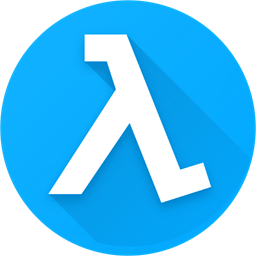

<p align="center">
  
</p>

<h1 align="center">HLSR 0.4.x (Electron)</h1>

<p align="center">
  Прежний лаунчер HLSR на Electron и Vue — для истории
</p>

> Это ветка для истории. Текущий лаунчер на Rust — в ветке
> [`main`](https://github.com/HL-HLSR/HLSR/tree/main), исправления и pull request
> принимаются только туда.
>
> This branch is kept for history. The current Rust launcher is in the
> [`main`](https://github.com/HL-HLSR/HLSR/tree/main) branch; fixes and pull
> requests go there only.

> HLSR — неофициальный проект сообщества. Он не связан с Valve Corporation и
> не одобрен ею. Half-Life, Half-Life 2, Steam и Source — товарные знаки
> Valve Corporation.
>
> HLSR is an unofficial community project, not affiliated with or endorsed by
> Valve Corporation. Half-Life, Half-Life 2, Steam and Source are trademarks
> of Valve Corporation.

## Что здесь / What is here

Исходный код HLSR 0.4.9 на Electron: главный процесс (`src/main`), интерфейс
на Vue (`src/renderer`), установщик и обновлялка (`src/installer`,
`src/updater`), самотесты (`scripts/*-selftest.js`). Скрипты выкладки,
выпуска игр и проверок против сервера сюда не входят: сервер hlsr.pro
закрыт.

The source of HLSR 0.4.9 on Electron: the main process (`src/main`), the Vue
UI (`src/renderer`), the installer and updater (`src/installer`,
`src/updater`), self-tests (`scripts/*-selftest.js`). Deployment, game
release and server-side QA scripts are not included: the hlsr.pro server is
closed source.

```bash
npm ci --legacy-peer-deps
npm run dev
```

## Лицензия / License

Код — [GNU GPL версии 3](LICENSE) (`GPL-3.0-only`). Название и логотип HLSR,
материалы игр Valve и другие чужие файлы под GPL не попадают — список в
[COPYING.md](COPYING.md), сторонние компоненты — в
[THIRD-PARTY-NOTICES.md](THIRD-PARTY-NOTICES.md).

The code is licensed under the [GNU GPL version 3](LICENSE)
(`GPL-3.0-only`). The HLSR name and logo, material from Valve games and
other third-party files are not covered: see [COPYING.md](COPYING.md) and
[THIRD-PARTY-NOTICES.md](THIRD-PARTY-NOTICES.md).
